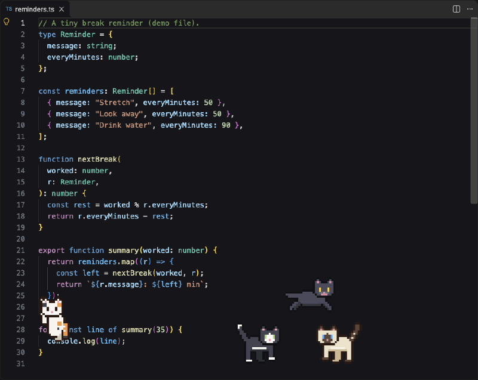

# Meowter

> Pixel-art cats take over your editor when it's time for a break.



## What it does

- Counts only the time you are actively using the editor, shared across all your windows.
- When the break is due, small pixel cats play on top of your code. They never block typing or clicking.
- Click **🐱 I took a break ⏸** in the status bar (or the notification) to send them away and restart the timer.
- If no editor is open, the cats play in a tab instead.
- Works in VS Code and Cursor.

## Cat styles

| Style | What the cat does |
| --- | --- |
| Wanderer | Walks, runs, sits, sleeps and swipes along the floor. |
| Climber | Climbs the side edges, hangs and grabs, then comes down. |
| Bouncer | Bounces in big arcs across the middle. |
| Yarn chaser | Chases and bats a ball of yarn. |
| Fighters | A pair that squares up, hisses and brawls in a dust cloud. |

Cats are dealt out to the enabled styles in turn, so the default 6 cats are one of each style. Fighters always take two cats, so a pair appears from 6 cats.

## Settings

| Setting | Default | Meaning |
| --- | --- | --- |
| `meowter.breakIntervalMinutes` | 50 | Minutes of active use before a break. |
| `meowter.idleThresholdMinutes` | 5 | Minutes without input after which time stops counting. |
| `meowter.catCount` | 6 | Cats per editor (2 to 30). |
| `meowter.styles` | all on | Turn each style on or off: `wanderer`, `climber`, `bouncer`, `yarnChaser`, `fighters`. |

Command: **Meowter: Set Break Interval**.

## Known limitations

- Cats move with the text when you scroll sideways.
- Very long lines can make the cats' area narrower than the editor.

## Development

```sh
npm ci
npm run compile
npm test
npx vsce package
```

## Releasing

Publishing is automatic: creating a GitHub release publishes the extension to the VS Code Marketplace and to Open VSX (for Cursor), and attaches the `.vsix` to the release.

1. Bump `version` in `package.json` and add a `CHANGELOG.md` entry; run `npm test` locally (CI runs only the unit tests); push to `main`.
2. Create a GitHub release with the tag `vX.Y.Z` (it must match `version`). Pre-releases are skipped and publish nothing.
3. If a store failed (outage, expired token), fix it and re-run: Actions, Publish, "Run workflow" with the tag. A version a store already has is skipped.

Needs two repository secrets (Settings, Secrets and variables, Actions): `VSCE_PAT` (Marketplace token) and `OVSX_PAT` (Open VSX token). The Open VSX namespace must exist once (`npx ovsx create-namespace <publisher> -p <token>`).

## License

MIT, see [LICENSE](LICENSE).
